<p align="center">
  
</p>

<h1 align="center">Lapse</h1>

<p align="center">Count time on the sites you choose.</p>

<p align="center">
  
  <a href="LICENSE"></a>
  <a href="https://github.com/acerothman/lapse/releases/latest"></a>
  <a href="https://github.com/acerothman/lapse/actions/workflows/build.yml"></a>
</p>

<p align="center">
  
  
</p>

## Why

Screen Time is a long report. Lapse watches a short list of sites and apps, keeps the total in the menu bar, and tells you when the day is used up. The record stays on your Mac.

## Features

- **The menu bar.** A ring that fills through the day. On a tracked site, its logo and a timer for the visit. Past the limit, red.
- **The popover.** Today's total, time and visits per site and app, the last seven days, and buttons to pause tracking or start focus hours.
- **Limits.** One daily limit for everything (1 h 30 min to start), plus an optional limit per site or app. A notification at 80% and at the limit.
- **Feed only.** Count only the feed on X, Reddit, YouTube, Instagram, TikTok, Facebook, LinkedIn and Threads. DMs, posting, notifications and settings don't count. X starts this way.
- **A pause before opening.** Before a site or app opens, a 10 second countdown, or a box where you type why. Per site, every time or only during focus hours or past a limit. Every pause and reason goes in a log.
- **A screen at the limit.** Snooze it for 5 or 15 minutes, or turn it off for the day.
- **Focus hours.** On a schedule, by hand, from Shortcuts, or with a macOS Focus. A stricter limit during that time, or a block.
- **Updates.** Lapse checks GitHub once a day and says so in the popover when there's a new version.
- **Open at login.**

Lapse starts with X, Instagram, TikTok, YouTube and Reddit turned on. Facebook, Threads, LinkedIn, Snapchat and Twitch are in the list too. Add any other domain, or any Mac app. Built-in logos are from Simple Icons (CC0).

## Screenshots

<p align="center">
  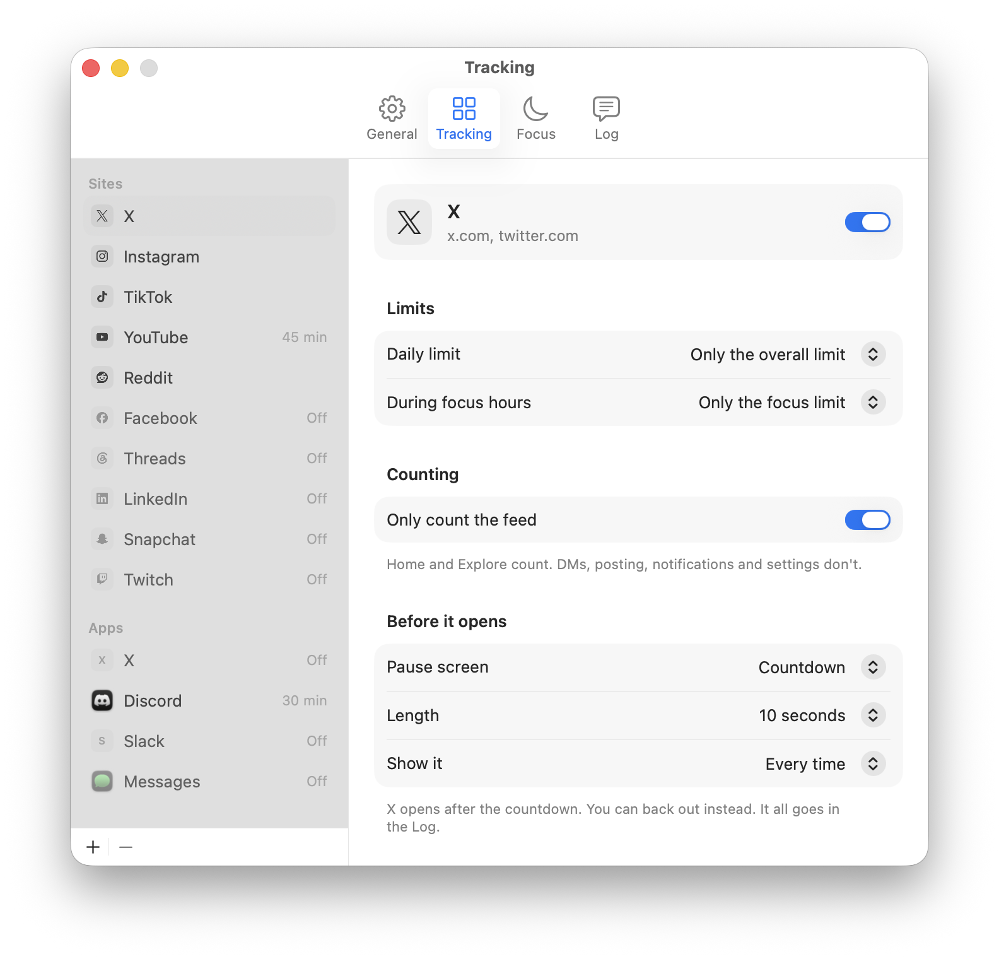
</p>

Each site and app has its own limits, feed setting and pause screen.

<p align="center">
  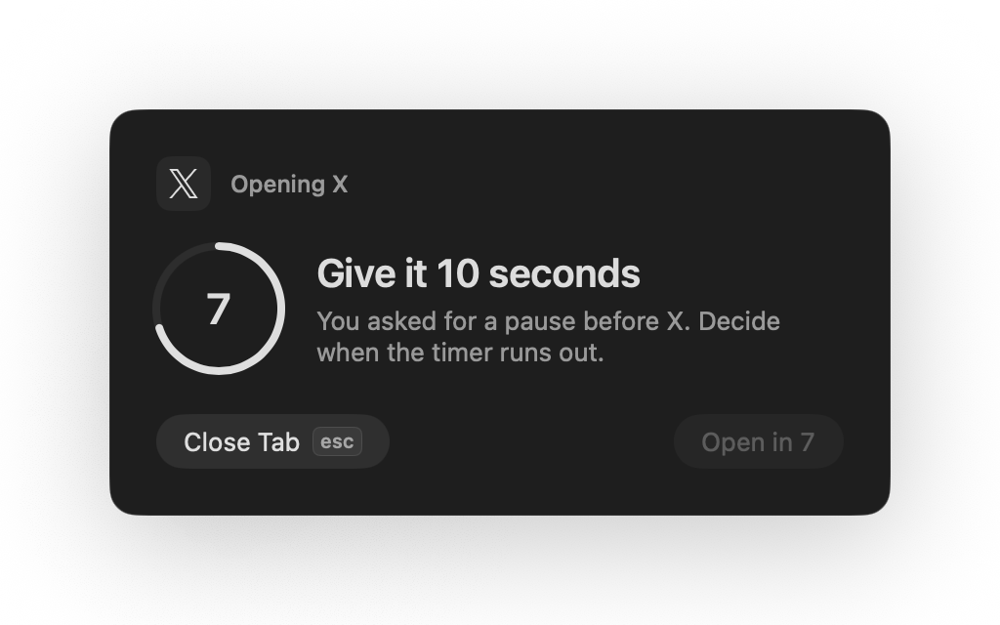
  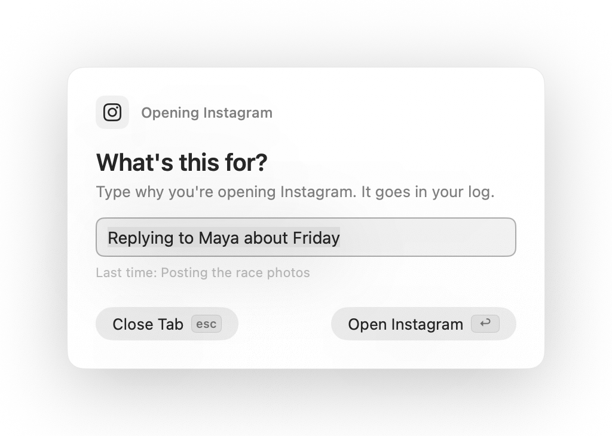
</p>

The pause screen. Wait out the countdown, or type a reason. Either way you can close the tab instead.

<p align="center">
  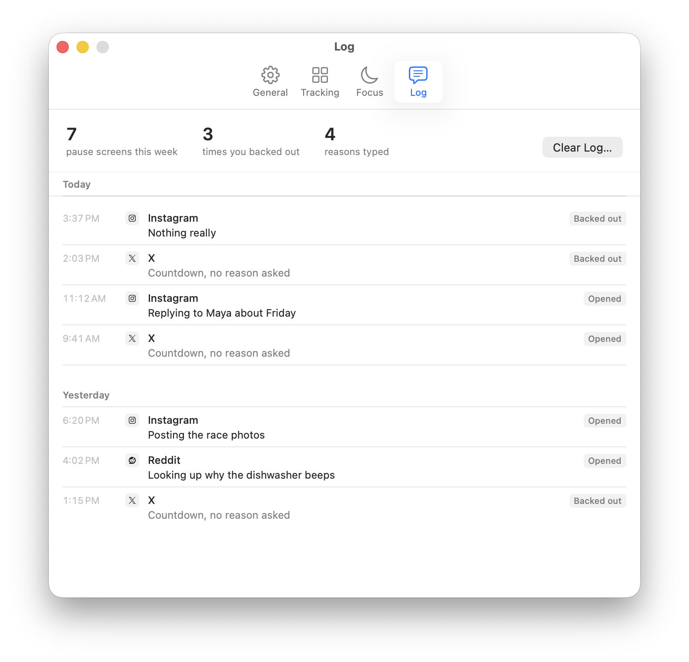
</p>

The log keeps every pause and reason, and counts the times you backed out.

<p align="center">
  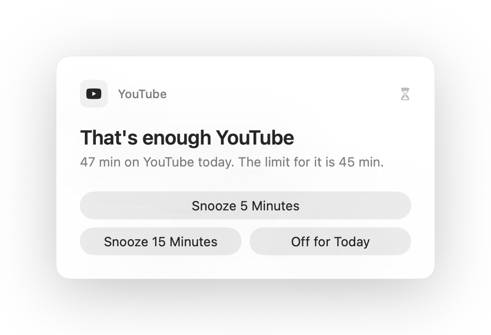
</p>

<p align="center">
  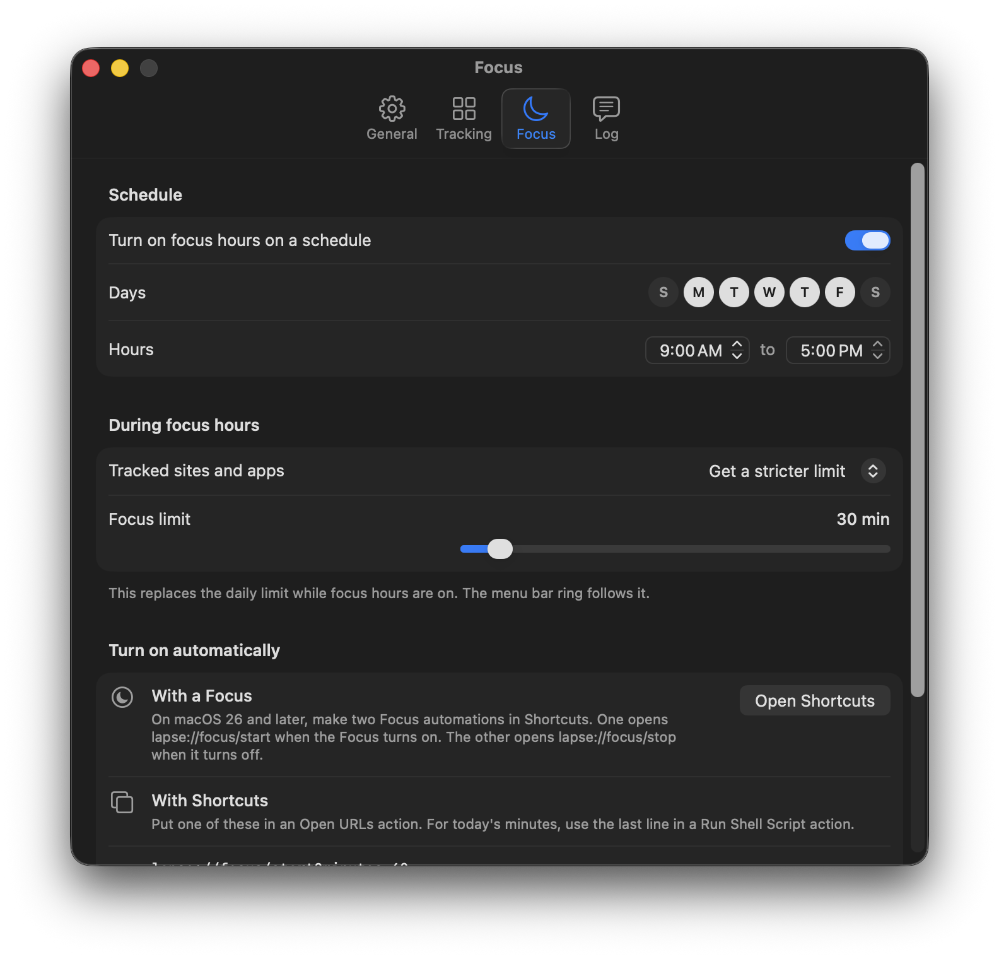
</p>

<p align="center">
  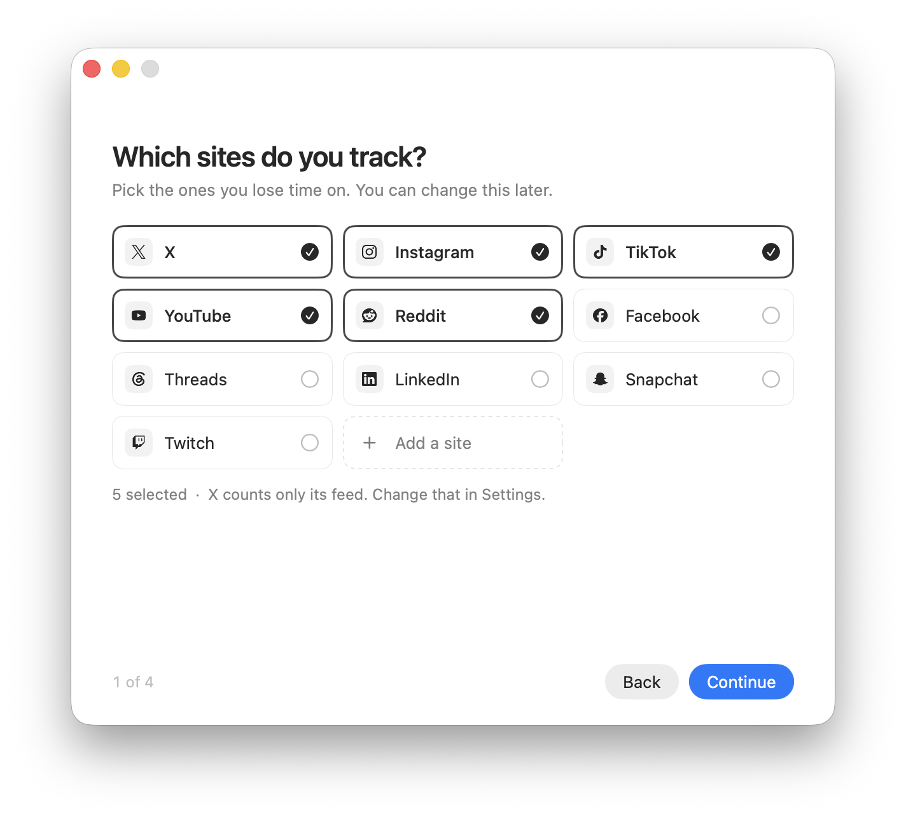
</p>

The menu bar shows one thing at a time. A ring while you're not on a tracked site. The site's logo and a timer while you are.

<p align="center">
  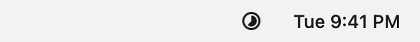
  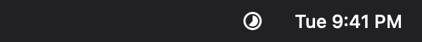
</p>
<p align="center">
  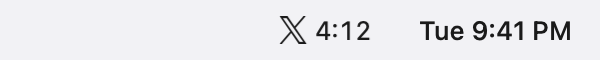
  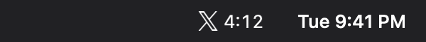
</p>

## Download

<p align="center">
  <a href="https://github.com/acerothman/lapse/releases/latest"></a>
</p>

Download `Lapse-1.2.0.zip` from the latest release, then run this in Terminal. It unzips the app, clears the quarantine flag, replaces any older copy in Applications and opens it.

```bash
cd ~/Downloads && rm -rf Lapse.app && unzip -o Lapse-1.2.0.zip && xattr -cr Lapse.app && rm -rf /Applications/Lapse.app && mv Lapse.app /Applications/ && open /Applications/Lapse.app
```

The build is ad hoc signed, not notarized, which is why the quarantine step is there. Your settings and history carry over from older versions.

## Shortcuts and Focus

Lapse answers `lapse://` links, so a Shortcuts **Open URLs** action can drive it.

| Link | Does |
| --- | --- |
| `lapse://focus/start?minutes=60` | Starts focus hours for an hour. Leave out `minutes` to keep them on until you end them. |
| `lapse://focus/stop` | Ends focus hours. A scheduled window stays off until it would have ended. |
| `lapse://pause?minutes=30` | Pauses tracking, limit screens and pause screens. Leave out `minutes` to pause until you resume. |
| `lapse://resume` | Starts counting again. |
| `lapse://limit?minutes=90` | Sets the daily limit. |
| `lapse://limit?minutes=20&site=reddit.com` | Sets a limit for one site or app, by domain, bundle id or name. `0` removes it. |

For today's total, use a **Run Shell Script** action:

```bash
defaults read com.acerothman.lapse todayMinutes
```

To follow a macOS Focus on macOS 26 or later, make two Focus automations in Shortcuts: one that opens `lapse://focus/start` when the Focus turns on, and one that opens `lapse://focus/stop` when it turns off.

Lapse also has native Shortcuts actions (start and end focus hours, pause and resume, get today's time, set a limit) and a Focus filter. macOS only offers those for apps signed by a developer team, and the download is signed ad hoc, so they show up only if you build Lapse yourself with your own team. Settings shows whichever applies to your copy.

## Privacy

Usage stays in `~/Library/Application Support/Lapse/data.json`: settings, seconds per site or app per day, visit counts, and the pause log with any reasons you typed. Days and log entries older than 90 are dropped. Icons for sites you add are PNGs in the `icons` folder next to that file. App icons are read from the apps themselves and are not saved. Delete the `Lapse` folder to reset. Clear the log on its own from Settings.

Lapse has no account and no analytics. It uses the network for two things: an icon for a site you added, and a check for a new version. The icon comes from the site's own `apple-touch-icon` and `icon` links, then `/favicon.ico`, then Google's favicon service if nothing else decodes. The update check reads the latest release from GitHub, on launch and once a day. Removing a site deletes its cached icon.

## Permissions

- **Automation.** Allow, in the welcome window, asks macOS to let Lapse control the browser in front (Safari, if none is open). That's how it reads the active tab's address, and how **Close Tab** on the pause screen works. If you deny it: System Settings → Privacy & Security → Automation → Lapse.
- **Notifications.** Allow in the welcome window. They're only the 80% and limit alerts. The same switch is in Settings.
- **Open at login.** On in the welcome window, and a toggle in Settings. macOS may ask you to approve the login item.

## How tracking works

About every two seconds, Lapse checks the frontmost app. While a tracked site or app is in front it checks about once a second, so the visit timer stays current. A tracked app counts by its bundle id. In a supported browser it reads the active tab's address with AppleScript.

Time counts when that host matches a site you turned on. Subdomains count: `old.reddit.com` counts for `reddit.com`. With feed only on, the path has to be a feed page too:

| Site | Counts with feed only | Doesn't count |
| --- | --- | --- |
| X | Home, Explore | DMs, posting, notifications, settings, profiles, single posts |
| Reddit | Front page, subreddit feeds | Comment threads, messages, chat, settings |
| YouTube | Home, Shorts | Videos you open, channels |
| Instagram | Home, Reels, Explore | DMs, profiles, settings |
| TikTok | For You, Following, Explore | Messages, uploads, settings |
| Facebook | News feed, Watch, Reels | Messages, notifications, settings |
| LinkedIn | Feed | Messages, jobs, profiles, notifications |
| Threads | Home | Activity, search, profiles |

The pause screen comes up when a site or app with one turned on comes to the front. Coming back within five minutes counts as the same visit, so switching tabs doesn't bring it back. Time doesn't count while it's up. **Close Tab** closes the browser tab, and **Hide** hides an app.

X on the Mac is the iPad app from the App Store, so it reports the iOS bundle id `com.atebits.Tweetie2`. Version 1.1 listed it as `com.x.twitter`, which never matched. 1.2 fixes that in your settings.

Counting pauses after the idle threshold (one minute without keyboard or mouse, by default) and while the Mac or the display is asleep. A visit shown in the menu bar ends when you leave the site for more than 30 seconds, or when you go idle.

## Browsers

| Browser | Tracked |
| --- | --- |
| Safari | Yes |
| Chrome | Yes |
| Arc | Yes |
| Brave | Yes |
| Edge | Yes |
| Vivaldi | Yes |
| Firefox | No |

Firefox doesn't expose the active tab to other apps, so Lapse can't count it. Safari Technology Preview is tracked the same way as Safari.

## Build from source

macOS 13 or later, and the Command Line Tools (`xcode-select --install`). With full Xcode selected, the build also writes the metadata Shortcuts actions and the Focus filter need. They only show up once the app is signed by a developer team.

```bash
git clone https://github.com/acerothman/lapse.git
cd lapse
./build.sh
```

`./build.sh` compiles with `swiftc`, draws the app icon, ad hoc signs the bundle, copies it to `~/Applications/Lapse.app`, and opens it. `./build.sh --no-open` stops after `build/Lapse.app`. CI uses that flag.

```bash
scripts/test.sh          # feed rules, limits, focus hours, pause screens, old data files, links
scripts/screenshots.sh   # the images in docs/, from the real app with made-up data
```

The screenshot script runs the app with a throwaway data folder, so your own data isn't touched. Your terminal needs Screen Recording access.

## Roadmap

Not in this version:

- A notarized download signed by a developer team. That removes the quarantine step and turns on the native Shortcuts actions and Focus filter for everyone.

## Contributing

See [CONTRIBUTING.md](CONTRIBUTING.md). The license is [MIT](LICENSE).
