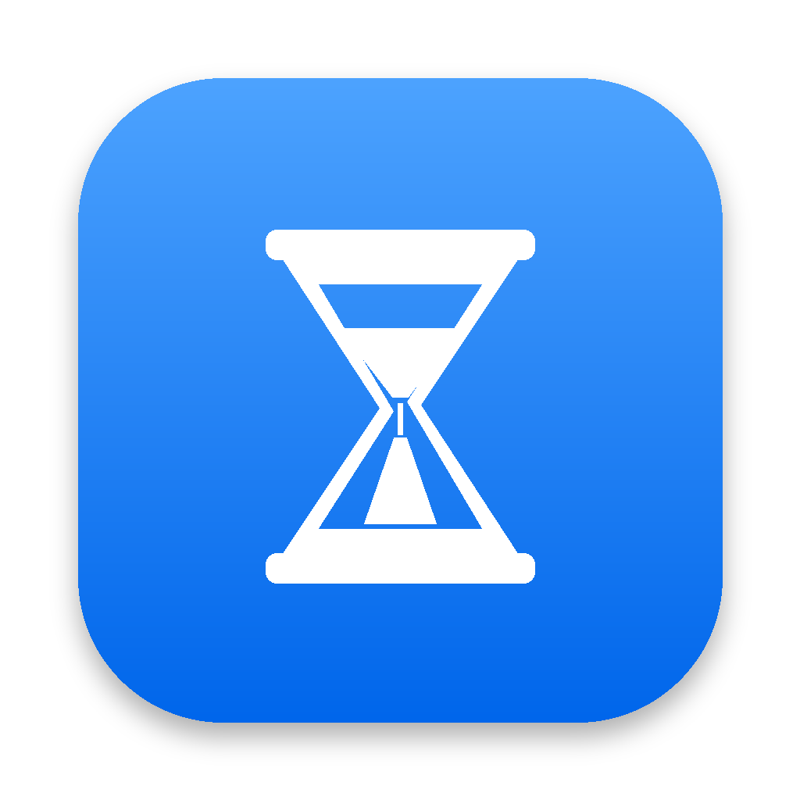
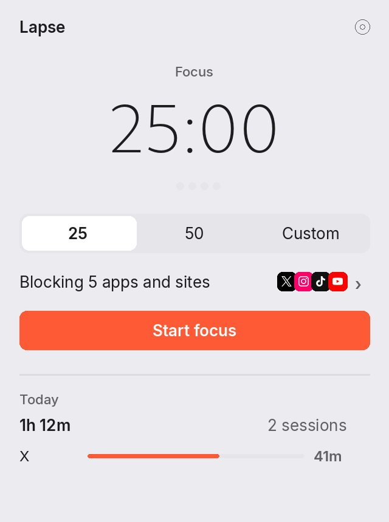
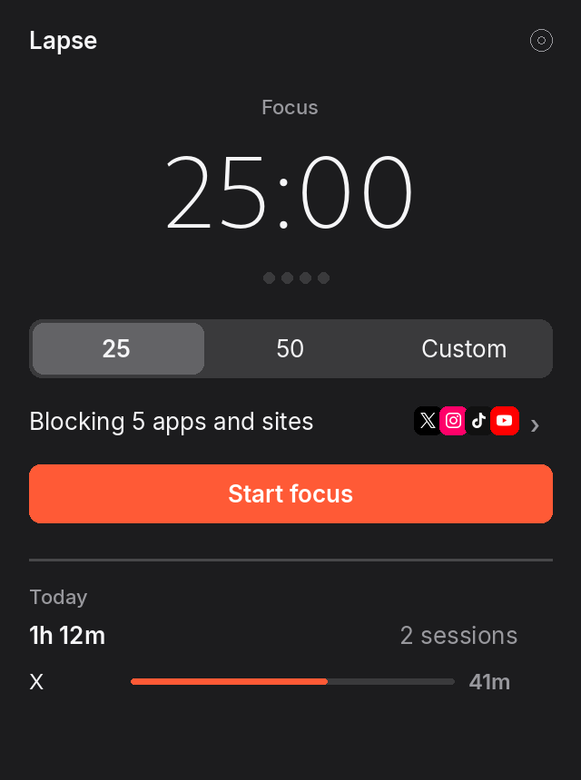
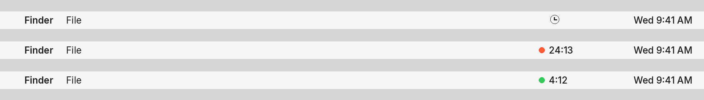
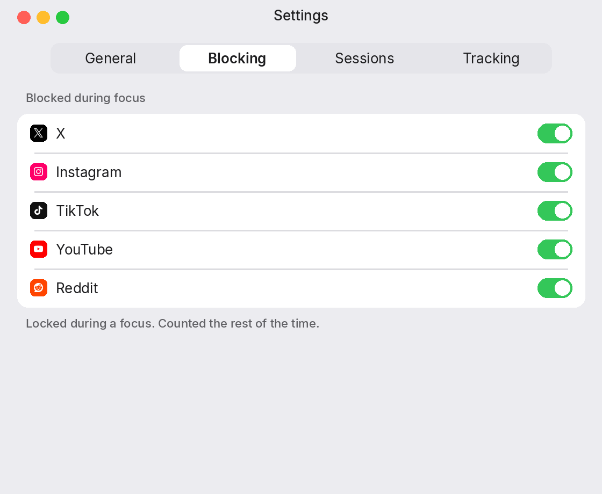
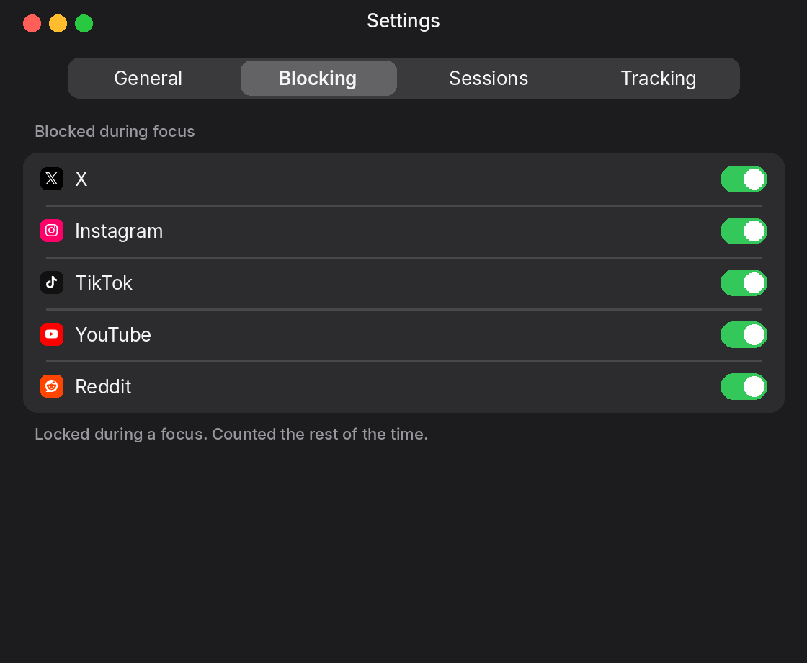
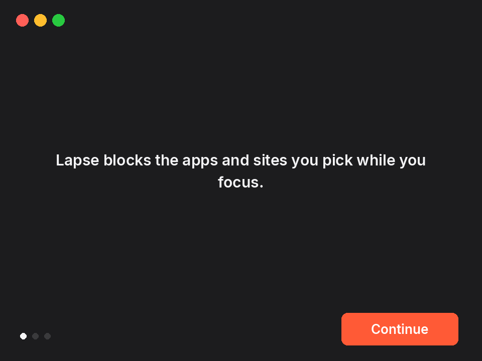

<p align="center">
  
</p>

<h1 align="center">Lapse</h1>

<p align="center">A focus timer that blocks the apps and sites you pick.</p>

<p align="center">
  
  <a href="LICENSE"></a>
  <a href="https://github.com/acerothman/lapse/releases/latest"></a>
  <a href="https://github.com/acerothman/lapse/actions/workflows/build.yml"></a>
</p>

<p align="center">
  
  
</p>

## Why

A focus session is the product. Pick the apps and sites that get in the way. Lapse hides or quits them while you focus, and covers one if you open it anyway. Breaks give them back. Time on those same apps and sites is still counted, on its own tab.

## Features

- A menu bar timer. Idle, it is a timer icon. During a focus, an accent dot and the countdown. During a break, a green dot and the countdown. The digits stay the menu bar's own color.
- Start from the menu bar. 25 minutes, 50, or a custom length. Short breaks are 5 minutes, long breaks 15, and a long break comes every 4 focuses. Change any of that in Settings.
- While a focus is running, the apps you turned on are hidden, or quit if you prefer that. They come back on the break. A blocked site or app in front gets a dark screen with the time left.
- Ending early takes a hold, or a short reason, using the same pause you set for opening something. Shortcuts can start a session. Ending one from Shortcuts opens that same prompt.
- A Focus can start a session. Turning that Focus off ends the session it started. A Focus can instead turn on stricter limits, or block outright, for the usage rules.
- A welcome window the first time Lapse opens: what it does, the list, then browser access, notifications, and open at login.
- Settings has four tabs. General, Blocking, Sessions, and Tracking. Blocking is the list a focus locks. Tracking keeps the daily limit, the limit screen, focus hours, feed-only counting, and the reasons you typed.
- X, Instagram, YouTube, and Reddit can count the feed only, outside a focus. A focus still blocks the whole site. X starts that way.
- Check for updates from the menu. Lapse also checks on launch and once a day, against GitHub releases.

It starts with X, Instagram, TikTok, YouTube, and Reddit turned on. Facebook, Threads, LinkedIn, Snapchat, and Twitch are in the list as well. Add any other domain. Built-in logos are from Simple Icons (CC0).

Apps start off. X, Discord, Slack, and Messages are listed. Turn one on, or add any other app. The Mac app for X is `com.atebits.Tweetie2`.

## Screenshots

<p align="center">
  
</p>

<p align="center">
  
  
</p>

<p align="center">
  
</p>

The menu bar shows one thing at a time. A timer icon while you are idle. A dot and the countdown while a session is running.

## Download

<p align="center">
  <a href="https://github.com/acerothman/lapse/releases/latest"></a>
</p>

Unzip `Lapse-1.2.0.zip` and move `Lapse.app` to your Applications folder. When a newer version is out, Lapse says so in the popover. Download stays on the releases page.

The build is ad hoc signed, not notarized, so a normal double-click is blocked. Right-click the app, choose **Open**, then **Open** again. Or clear the quarantine flag:

```bash
xattr -dr com.apple.quarantine /path/to/Lapse.app
```

## Privacy

Usage stays in `~/Library/Application Support/Lapse/data.json`: settings, the session in progress, finished focuses, seconds per site or app per day, visit counts, and reasons you typed. Days older than 90 are dropped. The session log keeps the latest 200 focuses. Reasons keep the latest 100. Icons for sites you add are PNGs in the `icons` folder next to that file. App icons are read from the apps themselves and are not saved. Delete the `Lapse` folder to reset.

Lapse has no account and no analytics. It uses the network for two things: an icon for a site you added, and a check for a new version. The icon comes from the site's own `apple-touch-icon` and `icon` links, then `/favicon.ico`, then Google's favicon service if nothing else decodes. The update check reads the latest release from GitHub, on launch and once a day. Removing a site deletes its cached icon.

## Permissions

- **Automation.** Allow, in the welcome window, asks macOS to let Lapse control the browser in front (Safari, if none is open). That is how a blocked site is recognized, and how time outside a focus is counted. If you deny it: System Settings, Privacy & Security, Automation, Lapse.
- **Notifications.** Allow in the welcome window. They are the limit alerts, and a note when a break or the next focus starts. The same switch is in Settings.
- **Open at login.** On in the welcome window, and a toggle in Settings. macOS may ask you to approve the login item.

## How a session works

Start focus from the menu bar. The length is the one you picked. When it ends, a short break starts, unless this focus was the last one before a long break. The next focus starts on its own when the break ends. Pause keeps the block up. End early, or Not now on the blocked screen, asks you to hold or to type a reason. Skip break starts the next focus.

During a focus, enabled apps are hidden, or quit and reopened on the break. Hide leaves them open. Quit closes them. The browser stays open. If the front tab is a blocked site, Lapse covers it. Back to work brings Finder forward.

A session keeps running if you quit and reopen Lapse, and catches up if the Mac was asleep. Quitting Lapse puts hidden apps back.

## How tracking works

Outside a focus, Lapse still counts the list. About every two seconds it checks the frontmost app. While a tracked site or app is in front, or a session is running, it checks about once a second. A tracked app counts by its bundle id. In a supported browser it reads the active tab's address with AppleScript.

Time counts when that host matches an enabled site. Subdomains count: `old.reddit.com` counts for `reddit.com`. Feed only, where it is on, counts the feed and not messages, a post you are writing, or settings. A focus ignores that and blocks the whole site.

Counting pauses after the idle threshold (60 seconds of no keyboard or mouse, by default) and while the Mac or the display is asleep. It also pauses while a focus has that site or app locked, so the block is not added to the day's total.

## Browsers

| Browser | Tracked |
| --- | --- |
| Safari | Yes |
| Chrome | Yes |
| Arc | Yes |
| Brave | Yes |
| Edge | Yes |
| Vivaldi | Yes |
| Firefox | No |

Firefox does not expose the active tab to other apps, so Lapse cannot see it. Safari Technology Preview is tracked the same way as Safari.

## Build from source

macOS 13 or later, and the Command Line Tools (`xcode-select --install`). Xcode is not required.

```bash
git clone https://github.com/acerothman/lapse.git
cd lapse
./build.sh
```

`./build.sh` compiles with `swiftc`, draws the app icon, writes App Intents metadata, ad hoc signs the bundle, copies it to `~/Applications/Lapse.app`, and opens it.

```bash
./build.sh --no-open
```

`--no-open` stops after `build/Lapse.app`. It does not install into `~/Applications` and it does not launch the app. CI uses this flag.

## Roadmap

Not in this version:

- A notarized download, so the Gatekeeper step above can go away.

## Contributing

See [CONTRIBUTING.md](CONTRIBUTING.md). The license is [MIT](LICENSE).
