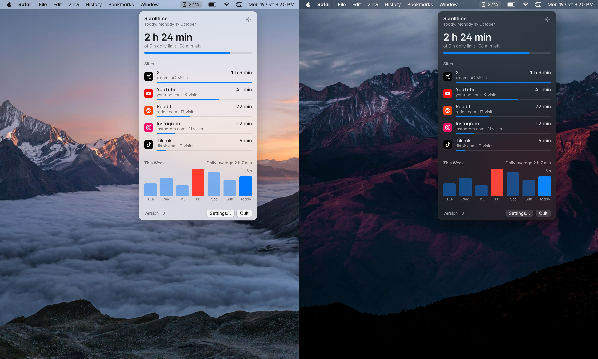
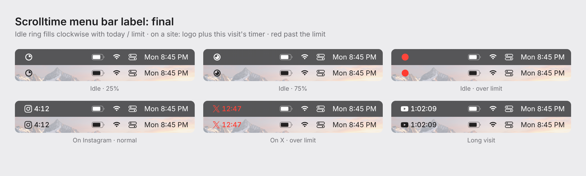
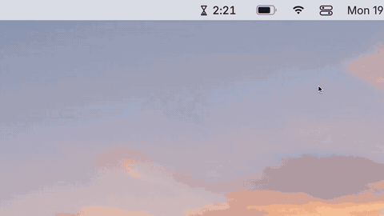

<p align="center">
  
</p>

<h1 align="center">Lapse</h1>

<p align="center">Count time on the sites you choose.</p>

<p align="center">
  
  <a href="LICENSE"></a>
  <a href="https://github.com/acerothman/lapse/releases/latest"></a>
  <a href="https://github.com/acerothman/lapse/actions/workflows/build.yml"></a>
</p>

<!-- TODO: swap in Lapse-branded assets when they arrive.
     docs/images/mockup-v4.png, docs/images/menubar-final.png,
     docs/images/scrolltime-ad.gif, docs/images/ad-poster.png,
     and docs/scrolltime-ad.mp4 still show the previous name. -->

<p align="center">
  
</p>

<p align="center"><em>The screenshots and the clip still show the previous name.</em></p>

## Why

Screen Time is a long report. Lapse watches a short list of sites, keeps the total in the menu bar, and tells you when the day is used up. The record stays on your Mac.

## Features

- A welcome window the first time Lapse opens. Pick sites, set the daily limit, allow browser access and notifications, and leave open at login on. Settings has Welcome to Lapse if you want it again.
- A popover with today's total, time and visits per site, and a chart of the last seven days.
- A menu bar ring that fills clockwise through the day. Past the limit it becomes a red dot.
- On a tracked site, the site's logo and a timer for the current visit (`4:12`, or `1:02:09` past an hour). Past the limit, the logo and the timer turn red.
- An icon for sites you add, fetched from the site and cached locally.
- A daily limit (1 h 30 min to start, from 15 min to 8 h) and a notification at 80% and at the limit, once each per day.
- Open at login.

It starts with X, Instagram, TikTok, YouTube, and Reddit turned on. Facebook, Threads, LinkedIn, Snapchat, and Twitch are in the list as well. Add any other domain, or right-click a site to remove it. Built-in logos are from Simple Icons (CC0).

<p align="center">
  
</p>

## Demo

<p align="center">
  
</p>

The clip is also stored as [docs/scrolltime-ad.mp4](docs/scrolltime-ad.mp4). A still is at [docs/images/ad-poster.png](docs/images/ad-poster.png).

## Download

<p align="center">
  <a href="https://github.com/acerothman/lapse/releases/latest"></a>
</p>

Unzip `Lapse-1.0.0.zip` and move `Lapse.app` to your Applications folder.

The build is ad hoc signed, not notarized, so a normal double-click is blocked. Right-click the app, choose **Open**, then **Open** again. Or clear the quarantine flag:

```bash
xattr -dr com.apple.quarantine /path/to/Lapse.app
```

## Privacy

Usage stays in `~/Library/Application Support/Lapse/data.json`: settings, seconds per site per day, and visit counts. Days older than 90 are dropped. Icons for sites you add are PNGs in the `icons` folder next to that file. Delete the `Lapse` folder to reset.

Lapse has no account, no analytics, and no server. The only network use is an icon for a site you added: the site's own `apple-touch-icon` and `icon` links, then `/favicon.ico`, then Google's favicon service if nothing else decodes. Removing a site deletes its cached icon.

## Permissions

- **Automation.** Allow, in the welcome window, asks macOS to let Lapse control the browser in front (Safari, if none is open). That is how the active tab address is read. If you deny it: System Settings → Privacy & Security → Automation → Lapse.
- **Notifications.** Allow in the welcome window. They are only the 80% and limit alerts. The same switch is in Settings.
- **Open at login.** On in the welcome window, and a toggle in Settings. macOS may ask you to approve the login item.

## How tracking works

About every two seconds, Lapse checks the frontmost app. While a tracked site is open it checks about once a second, so the visit timer stays current. In a supported browser it reads the active tab's address with AppleScript.

Time counts when that host matches an enabled site. Subdomains count: `old.reddit.com` counts for `reddit.com`.

Counting pauses after the idle threshold (60 seconds of no keyboard or mouse, by default) and while the Mac or the display is asleep. A visit shown in the menu bar ends when you leave the site for more than 30 seconds, or when you go idle.

## Browsers

| Browser | Tracked |
| --- | --- |
| Safari | Yes |
| Chrome | Yes |
| Arc | Yes |
| Brave | Yes |
| Edge | Yes |
| Vivaldi | Yes |
| Firefox | No |

Firefox does not expose the active tab to other apps, so Lapse cannot count it. Safari Technology Preview is tracked the same way as Safari.

## Build from source

macOS 13 or later, and the Command Line Tools (`xcode-select --install`). Xcode is not required.

```bash
git clone https://github.com/acerothman/lapse.git
cd lapse
./build.sh
```

`./build.sh` compiles with `swiftc`, draws the app icon, ad hoc signs the bundle, copies it to `~/Applications/Lapse.app`, and opens it.

```bash
./build.sh --no-open
```

`--no-open` stops after `build/Lapse.app`. It does not install into `~/Applications` and it does not launch the app. CI uses this flag.

## Roadmap

Not in this version:

- A limit per site, in addition to the daily total.
- A notarized download, so the Gatekeeper step above can go away.
- Screenshots and a clip that use the Lapse name.

## Contributing

See [CONTRIBUTING.md](CONTRIBUTING.md). The license is [MIT](LICENSE).
